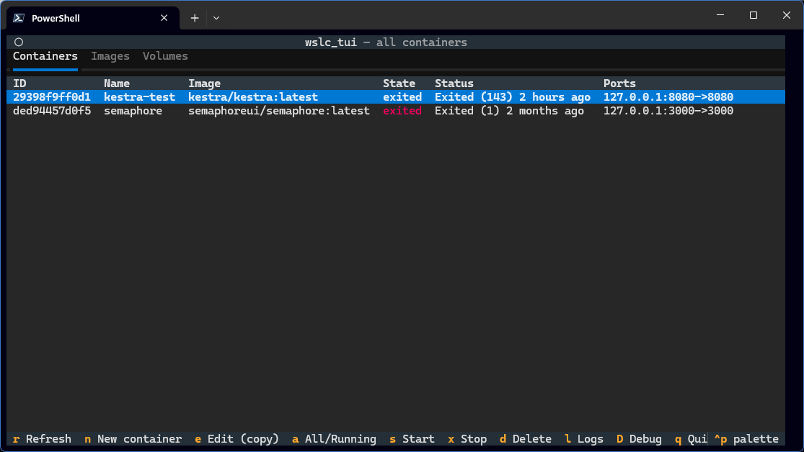
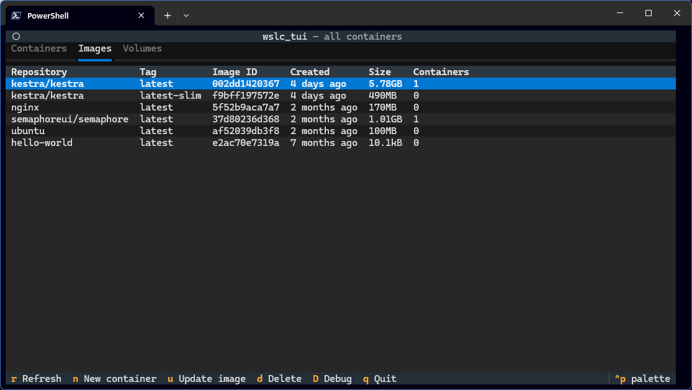
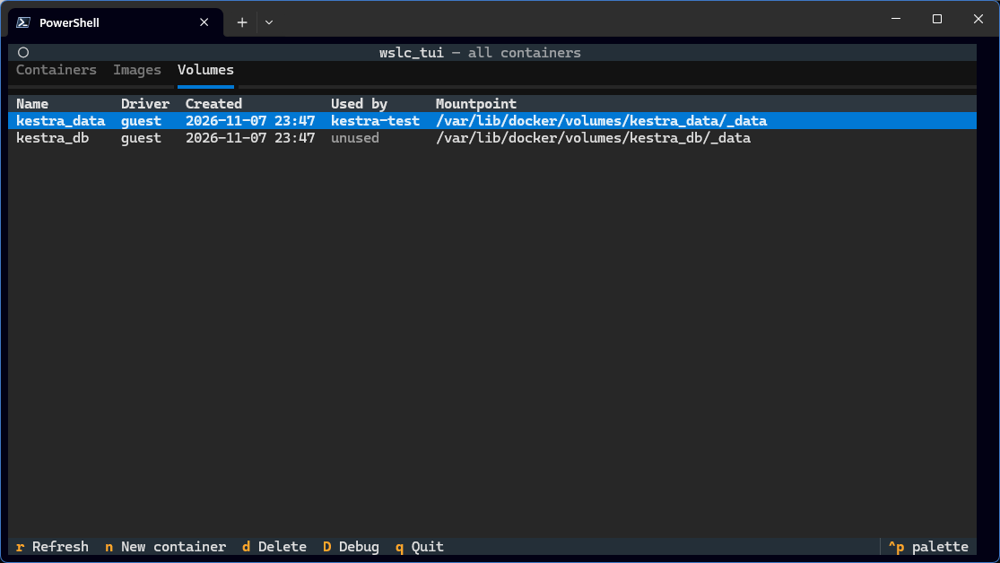

# wslc_tui

A terminal UI for the WSL container CLI (`wslc`), built with [Textual](https://textual.textualize.io/).

[](LICENSE) Free software under the GNU GPL v3 or later; see [License](#license).

- **Containers** tab: lists containers (all or running only) with state, status and ports; start, stop, delete or view logs of the highlighted container
- **Images** tab: lists local images and can update (re-pull) or delete the highlighted image
- **Volumes** tab: lists volumes with their creation time and the containers that use them, and can delete the highlighted volume
- **New container** form: create a container from an existing image, map ports, attach volumes and add any other `wslc run` options
- Refreshes automatically every 5 seconds





## Run

Requires Python 3.10 or later and WSL 3.x.

From the `wslc_tui` repository directory:

```powershell
pip install -r requirements.txt
python wslc_tui.py
```

## Keys

| Key | Action |
|-----|--------|
| `r` | Refresh |
| `n` | New container (opens the create form; preselects the highlighted image on the Images tab) |
| `e` | Edit selected container (saves a modified copy; the original is left unchanged) |
| `a` | Toggle all / running-only containers |
| `s` | Start selected container |
| `x` | Stop selected container |
| `l` | View logs of selected container |
| `D` | Show/hide the debug panel (see [Debug mode](#debug-mode)) |
| `H` | Hide/show auto-refresh commands in the debug panel |
| `Ctrl+Shift+A` | Show About (also available from the header command palette) |
| `u` | Update selected image (pulls the latest `repository:tag`) |
| `d` | Delete selected container, image or volume, depending on the tab (asks for confirmation; offers force delete for running containers or images in use) |
| `q` | Quit |

Container keys (`a`, `s`, `x`, `l`, `e`) only work on the Containers tab, and `u` only works on the Images tab.

Use the arrow keys to move between rows and click a tab (or use `Tab` to focus the tab bar) to switch tabs.

## Volumes

The **Volumes** tab lists every volume with its driver, creation time, mountpoint and **Used by**: the containers (running or stopped) that mount it, or *unused*.

Press `d` to delete the highlighted volume; its data is permanently lost. `wslc` can't delete a volume that's in use, so the confirmation lists the containers using it. Delete those containers first. There's no force option.

## Creating a container

Press `n` to open the form:

- **Image**: pick any local image.
- **Name**: optional; letters, digits, `_`, `.` and `-`.
- **Ports**: `host:container` (e.g. `8080:80`), optionally `ip:host:container/udp`. Press Enter or **Add port**; add as many as you need.
- **Volumes**: a source plus an absolute container path (e.g. `/data`), optionally read-only.
  - A **volume name** reuses an existing volume (names are suggested as you type) or creates a new one.
  - A **Windows folder** path (e.g. `C:\projects\site`) is bind-mounted; it must already exist.
- **Extra options**: optional; any other `wslc run` options, typed as on the command line, e.g. `--rm -e TZ=UTC --label app=web --network mynet --memory 512M`.
  - Quote values with spaces (`--health-cmd "curl -f http://localhost"`). Backslashes are kept as-is, so Windows paths work.
  - Only options are allowed here; text that should come after the image goes in **Command and arguments**. Unknown options are rejected before anything runs, so a stray word can't be mistaken for the image name. See `wslc run --help` for the full list.
  - `--name` and `-d`/`--detach` are rejected because the Name field and Start checkbox set them.
- **Command and arguments**: optional; text added after the image name, e.g. `server local`. Quote arguments with spaces (`sh -c "echo hi; sleep 60"`). Leave empty to use the image's default command.
- **Start the container after creating it**: on runs `wslc run --detach`; off runs `wslc create`.

Anything typed in the port or volume boxes but not yet added is included when you press **Create**. If creation fails, any volumes created for it are removed again.

## Editing a container

`wslc` can't change an existing container, so `e` opens the same form pre-filled from the highlighted container and **saves a new container** with your changes. The original is left untouched, so you can compare them and delete whichever you no longer need.

- **Editable:** name (defaults to `<name>-copy`), ports, volumes, extra options, command and arguments, and whether to start it.
- **Extra options** are pre-filled with the options the original was created with, so you can change or remove them. This works for containers created with extra options in this app; they're stored in a `wslc-tui.extra-options` label, without environment variable values, which are read back from the container. Ports, volumes and settings set by these options appear only in this field, not in the lists above.
- **Fixed:** the image. If the original's tag now points to a newer image, the copy uses the exact image the original was built from.
- **Carried over unchanged:** custom entrypoint, extra environment variables, working directory, user, and memory/CPU limits. Extra options are added last, so e.g. `--memory 1G` or `--entrypoint /bin/sh` replaces the carried-over value.
- Named volumes are shared with the original; files stored only inside the original container are not copied.
- If the original is running, **Start** is unticked by default, and starting is blocked while the copy would use the same host ports (including `-p` ports in extra options).

## Viewing logs

Press `l` on a container to open its logs (stdout and stderr together). Running containers are followed live; stopped containers show a snapshot. The last 500 lines are loaded by default.

| Key | Action |
|-----|--------|
| `f` | Toggle following live output |
| `t` | Toggle timestamps |
| `a` | Toggle all lines / last 500 lines |
| `r` | Reload |
| `Home` / `End` | Jump to top / bottom |
| `Esc` / `q` | Close the viewer |

## Debug mode

The debug panel lists every `wslc` command the TUI runs, with its result:

```text
00:10:40.284  #1 ✓ exit 0 · 107 ms  wslc list --format json --all  [refresh]
00:10:41.010  #4 ✗ exit 1 · 65 ms  wslc start doesnotexist123  — Container 'doesnotexist123' not found.
00:10:42.377  #11 … running  wslc logs --tail 500 --follow eb11aae39f1c
00:10:43.529  #11 ■ stopped by log viewer · 2.2 s  wslc logs --tail 500 --follow eb11aae39f1c
```

- Press `D` to show or hide it, or start with it open:

  ```powershell
  python wslc_tui.py --debug
  ```

- Commands from the 5-second auto refresh are dimmed and tagged `[refresh]`; press `H` to hide or show them.
- Commands still running after a second (pulls, followed logs) get a `… running` line straight away, then a result line when they finish.
- Failures show the exit code and the first line of the error. The panel title counts commands run and failed.
- Environment variable values (`--env NAME=value`) are shown as `NAME=***`.
- To keep a record, add `--debug-log FILE` to append every command and result to a file (works with or without `--debug`):

  ```powershell
  python wslc_tui.py --debug --debug-log wslc-debug.log
  ```

## License

wslc_tui — a terminal UI for the WSL container CLI  
Copyright (C) 2026 Brian Frost

This program is free software: you can redistribute it and/or modify it under the terms of the GNU General Public License as published by the Free Software Foundation, either version 3 of the License, or (at your option) any later version.

This program is distributed in the hope that it will be useful, but WITHOUT ANY WARRANTY; without even the implied warranty of MERCHANTABILITY or FITNESS FOR A PARTICULAR PURPOSE. See the GNU General Public License for more details.

You should have received a copy of the GNU General Public License along with this program (see [LICENSE](LICENSE)). If not, see <https://www.gnu.org/licenses/>.

SPDX-License-Identifier: `GPL-3.0-or-later`

The dependencies [Textual](https://github.com/Textualize/textual) and [Rich](https://github.com/Textualize/rich) are MIT-licensed by their respective authors.
